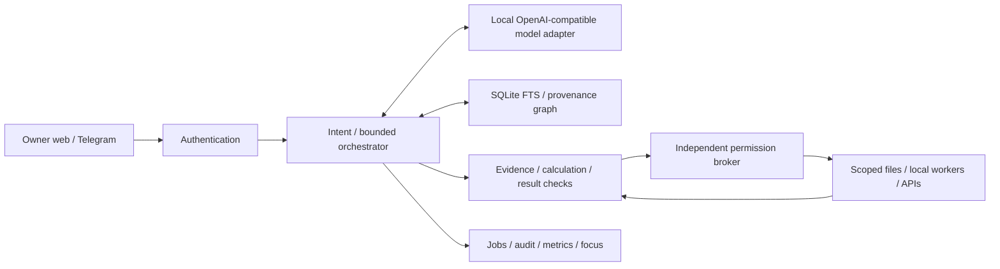

# Technical architecture

## Decisions
Small Python/FastAPI service, SQLite durable state, plain web UI, httpx adapters; avoid Redis, Kubernetes, default agent swarms. Native host service first; optional containers with explicit mounts. The application is runnable without GPU/model downloads, but inference is not simulated as a working brain.

Request flow: authenticate; classify; retrieve minimal evidence; select allowed model; validate structured tool requests; broker checks resource/action limits; execute with timeout; verify resulting state; concise response; redacted audit receipt. Retrieved documents never grant authority. No arbitrary model-generated shell execution.

## Storage and vault
SQLite jobs, focus sessions, audit, source catalog, chunks/FTS, graph relationships. Index only configured roots; refuse credential/system paths and symlink escapes. Content hashes support incremental updates; deletion invalidates derived evidence. Markdown exports remain portable. Obsidian is an optional proprietary viewer, not an open-source backend. Graphify/Memoria/Tesserae require further identity/license/API validation; a graph server is unjustified initially.

## Model selection and research
Text compatibility baseline: Qwen3 8B. Newer Qwen3.5 4B/9B, Qwen3-VL 8B and Qwen3.8 27B are research candidates, pending exact weight-license and hardware evaluation; see RESEARCH.md. No claim that the older baseline is the best current model. llama.cpp or Ollama exposes swappable local HTTP inference. Image requests require an image-capable model configured at that endpoint; the default text model does not provide vision. Implemented voice adapters use whisper.cpp and Piper; voice-weight licenses are a separate deployment check. Image generation requires an explicitly configured local wrapper, not bundled weights. Embeddings/vector storage deferred until lexical retrieval is measured.

Official Codex sign-in with ChatGPT is distinct from general-purpose subscription-funded API access. The optional `jarvis frontier` CLI wraps supported official Codex execution with a separate owner login and explicit enable; never attaches vault/chat context. It is a trusted external provider, not a broker-constrained host worker. See CODEX.md. Generic API adapters require authorized credentials. No extracted tokens, reused cookies, invented OAuth scopes, or unlimited-call claims; deterministic local commands remain available when inference is unavailable.

## Security
Local service binds 127.0.0.1 by default. Persistent random bearer token in a mode-0600 file; private network plus authentication for remote access. Credentials supplied by environment/OS credential manager and omitted from logs/backups. Scope paths, cap sizes, reject symlink escapes, allowlist external hosts, impose tool/job timeouts and retry budgets. Python command allowlisting is not an OS sandbox: arbitrary terminal execution is disabled unless a separately configured isolated worker is available. Audit records structured facts/receipts, not hidden chain-of-thought. Malware on the same owner account is outside the bearer token threat model.

## Reach and deployment
WireGuard or Tailscale private network, no public forwarding by default. Telegram official Bot API with owner chat allowlist; WhatsApp official Business API only; Twilio owner-only budgeted outbound calls. External credentials and webhook/media routing are deployment prerequisites, not implementation claims. Same-origin web UI keeps its access token in session memory, never in URLs. Containers cannot grant full desktop control safely; host-specific accessibility adapters are separate optional capabilities.

## Quality, returns, recovery
Deterministic arithmetic with units; source-grounded extractive fallback; unknown claims abstain. Model answers remain labeled inference, not verified facts. Expected net value = probability-weighted benefit - cost - expected loss; ranges required when inputs uncertain. Hard privacy/budget constraints precede scoring. Jobs persist state and idempotency keys; ambiguous external outcomes need reconciliation, not blind retries. Repairs limited to owned workers/derived indexes; no privilege/policy changes.

## Portability
Versioned configuration, database, exports, lockfile, model manifests. Host drivers, browser runtimes, OS permissions and secrets need rebinding. Restore never assumes old processes or network sessions survive. Tests use temporary state; production data is untouched.
