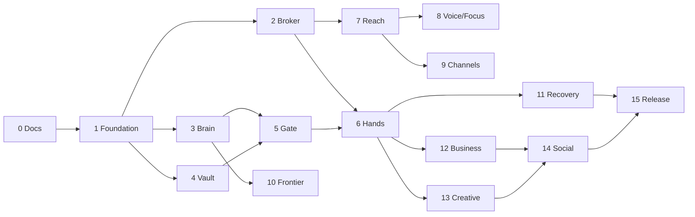

# Jarvis implementation plan

> For agentic workers: use test-driven implementation and independent review. User authorized the complete build without further approval.

Goal: deliver a working local-first operator in independently verifiable blocks.
Architecture: typed adapters around a small authenticated service; SQLite persistence; independent broker.
Tech stack: Python >=3.11, FastAPI, httpx, SQLite, optional Playwright/FFmpeg and local model runtime.
Spec: PRD.md and ARCHITECTURE.md.

## Global constraints
Use existing isolated cloud checkout; do not create worktrees. No publishing, credential extraction, unconditional host shell, or silent cloud egress. Persistent data/secrets excluded from Git. Each block: code, tests, use/verify note. Hardware/account capabilities remain explicitly unavailable until configured and exercised.

## Review focus
Path traversal and symlinks must not escape scopes. Duplicate requests must not duplicate effects. Untrusted content must not bypass policy. Missing model/credentials must not look successful. Authentication and backups must not expose secrets.

## Contracts and tasks
Every task follows: write behavioral tests; observe missing behavior; implement; run targeted tests; integrate full suite; record evidence in STATUS.md.

| Block | Files / interface | Required verification |
|---|---|---|
| 0 documentation | docs/*.md | source claims labeled, dependencies explicit |
| 1 foundation | config.py Settings, cli.py main, app.py create_app(settings) | invalid config, hardware report, CLI init, token privacy |
| 2 broker/audit | security.py Broker, store.py Store | traversal/symlink denial, redaction, denied tools |
| 3 brain | models.py LocalModel.chat(messages), vision | mock HTTP protocol, unavailable endpoint, budgets |
| 4 vault | vault.py Vault(roots, db_path); index/search/graph | update/delete/provenance, denied roots |
| 5 gate | quality.py calculate / rank, orchestrator.py | arithmetic limits, factual abstention, returns ranking |
| 6 hands | tools.py ToolService | read/write verification, scope denial, browser constraints |
| 7 reach | app.py / static/* | bearer authentication, authenticated flows, mobile UI |
| 8 voice/focus | focus.py, extensions/voice.py | sessions/pause/complete, unavailable engine, bounded audio |
| 9 notifications | extensions/channels.py | Telegram allowlist, WhatsApp official API, Twilio budgets/fallback |
| 10 frontier | models.py cloud policy, codex_provider.py, CLI / docs/CODEX.md | no undocumented subscription proxy; explicit owner CLI/login; bounded unverified suggestions |
| 11 recovery | jobs.py durable state | restart, retries, idempotency, ambiguous-effect handling |
| 12 business | extensions/business.py | CSV reports, explicit ROI/risk inputs, invalid data |
| 13 creative | extensions/creative.py | usable website, real FFmpeg render, configured image adapter |
| 14 social | extensions/social.py | official API adapter, policy/caps/pause, receipts |
| 15 release | Dockerfile, scripts, docs/OPERATIONS.md | install/wheel/smoke/backup restore/full suite |

Independent vault, model/research, integration packs, and frontend work may be delegated with exclusive file ownership; root owns config/broker/store/API integration. No agent stages another agent's files.
